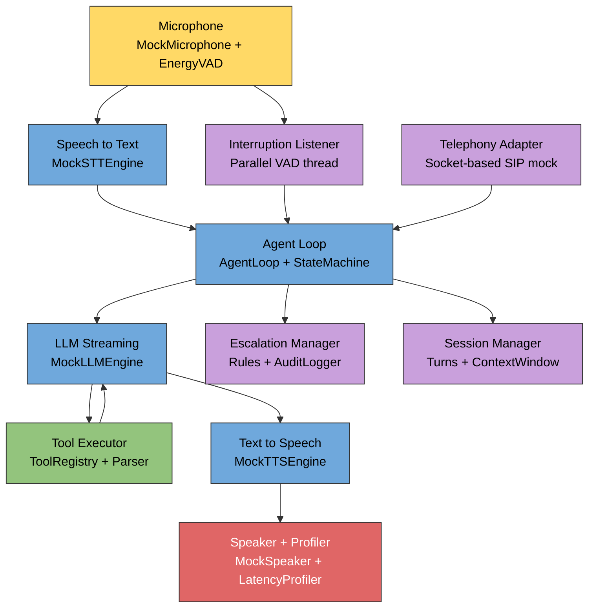

# Real-Time Voice Ops Agent

A fully self-contained Python voice agent that demonstrates sub-second speech-to-speech round-trips with streaming LLM responses, mid-utterance interruption handling, structured tool calling, configurable escalation paths, and a mock telephony layer — all built on deterministic mocks so there is nothing to install beyond Python and pytest.

---

## Features

- **Sub-second latency pipeline** — STT → first LLM token and TTS first-chunk both measured and asserted under 1 second via `LatencyProfiler`
- **Streaming LLM responses** — `MockLLMEngine` streams word-by-word tokens with configurable per-token and first-token latency
- **Interruption handling** — `InterruptionListener` runs a parallel VAD thread during TTS playback; on user speech it halts the speaker, cancels the LLM stream, and re-enters STT
- **State machine** — `StateMachine` enforces valid `IDLE → LISTENING → TRANSCRIBING → LLM_STREAMING → TTS_PLAYING → IDLE` transitions (plus interruption and error paths)
- **Tool calling** — LLM embeds `TOOL_CALL:<name>:<json>` directives; `ToolExecutor` parses them, executes the named tool, injects results into context, and re-invokes the LLM
- **Mock tool registry** — weather lookup, calendar check, order status, and knowledge-base search; all deterministic
- **Destructive tool gate** — `HumanInTheLoopConfirmation` blocks `order_cancel` and `data_delete` until explicitly approved (auto-approve/deny flags for tests)
- **Escalation paths** — three configurable rules: low STT confidence, repeated failures, and explicit user request; all events written to a local JSON audit log
- **Session manager** — per-call turn history with speaker diarization stubs, context windowing (token-budget eviction), and full serialisation
- **Mock telephony adapter** — in-process Unix socket pair simulates SIP/PSTN; `ScenarioPlayer` replays five built-in call scripts (happy path, escalation, DTMF menu, multi-turn, silent caller)
- **Environment-variable configuration** — every latency and behaviour knob is readable from a `.env` file or the shell

---

## Architecture



---

## Installation

**Requirements:** Python 3.9+, no external runtime dependencies.

```bash
# Clone / enter the project
git clone <repo-url>
cd voice-ops-agent

# Install (editable)
pip install -e .

# Install test dependencies
pip install pytest
```

---

## Usage

### Run the full voice round-trip

```bash
python -m voice_ops_agent
```

This runs one complete turn: simulated microphone → VAD → STT → streaming LLM → TTS → speaker, then prints a latency report.

### Configure via environment variables

```bash
# Use a fixed transcript so every run is deterministic
STT_TRANSCRIPT="What is the weather in London?" python -m voice_ops_agent

# Zero out all simulated latencies for benchmarking
STT_LATENCY=0 LLM_TOKEN_LATENCY=0 LLM_FIRST_LATENCY=0 TTS_LATENCY=0 python -m voice_ops_agent

# Pin the LLM to a specific reply
LLM_RESPONSE="It is sunny and 72 degrees." python -m voice_ops_agent
```

### Use a `.env` file

```bash
cp .env.example .env
# edit .env, then:
python -m voice_ops_agent
```

### Run all tests

```bash
pytest tests/ -v
```

### Install the console script entry point

```bash
voice-ops          # equivalent to python -m voice_ops_agent
```

---

## Project Structure

```
voice_ops_agent/
├── __init__.py              # package; exports __version__ = "0.1.0"
├── __main__.py              # CLI entry point: audio capture → agent loop → latency report
├── profiler.py              # public re-export of LatencyProfiler
├── profiler_impl.py         # LatencyProfiler: wraps AgentLoop, asserts SLA budgets
│
├── audio/
│   ├── input.py             # MockMicrophone: sine-wave + silence stream, record_until_silence()
│   └── output.py            # MockSpeaker: play_chunk(), interrupt(), reset()
│
├── vad/
│   └── detector.py          # EnergyVAD: RMS energy threshold, is_speech()
│
├── stt/
│   └── engine.py            # MockSTTEngine: returns fixed or random transcript + confidence
│
├── llm/
│   └── engine.py            # MockLLMEngine: intent-matched canned replies, word-by-word streaming
│
├── tts/
│   └── engine.py            # MockTTSEngine: sine-wave PCM proportional to word count
│
├── agent/
│   ├── loop.py              # AgentLoop: full STT→LLM→tools→TTS orchestrator
│   ├── state.py             # AgentState enum + StateMachine (enforced transitions)
│   ├── interruption.py      # InterruptionListener: background VAD thread during playback
│   └── tool_executor.py     # ToolExecutor: runs intents, injects ToolResult into context
│
├── tools/
│   ├── base.py              # BaseTool ABC, ToolResult dataclass
│   ├── registry.py          # ToolRegistry + default_registry() factory
│   ├── parser.py            # parse_tool_calls(), has_tool_call(), strip_tool_calls()
│   ├── mock_tools.py        # WeatherLookupTool, CalendarCheckTool, OrderStatusTool, KnowledgeBaseSearchTool
│   └── destructive_tools.py # OrderCancelTool, DataDeleteTool (require HITL confirmation)
│
├── escalation/
│   ├── rules.py             # ConfidenceThresholdRule, RepeatedFailureRule, ExplicitRequestRule
│   ├── manager.py           # EscalationManager: check() + escalate() + check_and_escalate()
│   ├── audit.py             # AuditLogger: thread-safe JSON file writer
│   └── hitl.py              # HumanInTheLoopConfirmation: auto-approve/deny + interactive prompt
│
├── session/
│   ├── manager.py           # SessionManager, Turn, Speaker enum
│   ├── context_window.py    # ContextWindow: FIFO token-budget eviction
│   ├── diarization.py       # DiarizationStub: assigns speaker labels per turn
│   └── call_handler.py      # CallHandler: wires SessionManager + AgentLoop + TelephonyAdapter
│
└── telephony/
    ├── adapter.py           # MockTelephonyAdapter: Unix socketpair, CallEvent, CallState
    └── scenarios.py         # ScenarioPlayer + SCENARIOS dict (5 built-in scripts)

tests/
├── test_day1.py             # VAD, MockMicrophone, MockSpeaker, MockSTTEngine
├── test_day2.py             # MockLLMEngine, MockTTSEngine, AgentLoop integration
├── test_day3.py             # StateMachine, InterruptionListener, interruption integration
├── test_day4.py             # Tool registry, parser, ToolExecutor, multi-tool conversations
├── test_day5.py             # Escalation rules, EscalationManager, AuditLogger, HITL
├── test_day6.py             # SessionManager, ContextWindow, DiarizationStub, TelephonyAdapter
└── test_day7.py             # Full scenario suite + LatencyProfiler SLA assertions
```

---

## How It Works

### 1 — Audio capture and VAD

`MockMicrophone.record_until_silence(vad)` streams chunks of 16-bit PCM. `EnergyVAD.is_speech()` computes the RMS energy of each chunk and compares it to a configurable threshold (default 300). Leading silence is skipped; trailing silence triggers end-of-utterance.

### 2 — STT

`MockSTTEngine.transcribe(chunks)` applies a configurable latency then returns a transcript (either the fixed `STT_TRANSCRIPT` env value or a random utterance from an internal corpus), plus a confidence score and approximate duration.

### 3 — LLM streaming with tool calling

`MockLLMEngine.stream_response()` yields one word at a time. The LLM can embed `TOOL_CALL:<name>:<json>` directives anywhere in its output. The agent loop accumulates the full response, then:

1. `has_tool_call()` checks for directives.
2. `parse_tool_calls()` extracts one or more `ToolCallIntent` objects.
3. `ToolExecutor.execute_all()` runs each tool via `ToolRegistry` and appends `ToolResult.to_context_dict()` entries to the conversation context.
4. The LLM is re-invoked with the enriched context. This loop repeats up to `max_tool_rounds` (default 5) times.
5. `strip_tool_calls()` removes directives from the final human-facing response.

### 4 — Interruption handling

While TTS audio is streamed to `MockSpeaker`, `InterruptionListener` runs in a daemon thread polling an `audio_source` callable. If `EnergyVAD.is_speech()` fires:

- `speaker.interrupt()` halts playback immediately.
- `llm.cancel()` sets a flag checked between streaming tokens.
- The agent transitions to `INTERRUPTED → LISTENING` and re-enters the STT phase with the newly captured audio.

Interruptions are capped at `max_interruptions` (default 3).

### 5 — Escalation

After every user turn, `EscalationManager.check_and_escalate(state)` evaluates rules in order (first match wins):

| Rule | Condition |
|---|---|
| `ConfidenceThresholdRule` | STT confidence < threshold (default 0.5) |
| `RepeatedFailureRule` | consecutive failures ≥ max (default 3) |
| `ExplicitRequestRule` | transcript contains keywords like "human", "agent", "representative" |

When a rule fires, an `EscalationEvent` is written to `escalation_audit.json` and the human-agent response string is returned (and spoken).

Destructive tools (`order_cancel`, `data_delete`) are gated by `HumanInTheLoopConfirmation.confirm_if_destructive()`, which can be set to auto-approve, auto-deny, or prompt interactively.

### 6 — Session management

`SessionManager` records every `Turn` (user, agent, tool, human_agent) with a UUID, timestamp, speaker enum, and arbitrary metadata. `ContextWindow` maintains a sliding window of turns trimmed to fit within a configurable token budget (estimated as word count). `DiarizationStub` accepts a speaker hint and can be overridden for testing.

### 7 — Mock telephony

`MockTelephonyAdapter` creates a Unix socket pair. The caller side sends line-delimited JSON `CallEvent` messages (`CALL_START`, `AUDIO_IN`, `DTMF`, `CALL_END`); the agent side reads them in a background thread and fires `on_event`. `ScenarioPlayer` replays one of five built-in `Scenario` objects (`happy_path`, `escalation`, `dtmf_menu`, `multi_turn`, `silent_caller`) through the adapter. `CallHandler` wires everything together: it receives events, drives `AgentLoop`, records turns in `SessionManager`, checks escalation, and calls `adapter.agent_respond()`.

### 8 — Latency profiling

`LatencyProfiler` wraps `AgentLoop.run()` and collects the `timings` dict returned by each run. `assert_sub_second()` raises `AssertionError` if `stt_to_first_token` or `tts_first_chunk_latency` exceed their budgets. `report()` formats all timings as a human-readable string.

---

## Environment Variable Reference

| Variable | Default | Description |
|---|---|---|
| `VAD_THRESHOLD` | `300` | RMS energy threshold for VAD speech detection |
| `STT_TRANSCRIPT` | _(random)_ | Fixed STT transcript; leave blank for random utterance |
| `STT_LATENCY` | `0.05` | Simulated STT processing delay (seconds) |
| `LLM_TOKEN_LATENCY` | `0.02` | Delay between streamed LLM word tokens (seconds) |
| `LLM_FIRST_LATENCY` | `0.05` | Simulated LLM time-to-first-token (seconds) |
| `LLM_RESPONSE` | _(intent-matched)_ | Fixed LLM reply; leave blank for canned intent matching |
| `TTS_LATENCY` | `0.03` | Simulated TTS first-chunk latency (seconds) |

---

## Notes and Roadmap

**Current limitations (by design)**

- All I/O is mocked — no real microphone, speaker, LLM API, or telephony hardware is used. The architecture is intentionally identical to what a real integration would require; swap each `Mock*` class for a real client.
- Token counting uses word-count heuristics (`len(text.split())`). A production system would use a proper tokeniser.
- The `DiarizationStub` accepts a caller-supplied hint rather than performing acoustic speaker identification.
- The `MockTelephonyAdapter` uses `AF_UNIX` socket pairs and does not implement real SIP signalling or RTP media.

**Natural next steps**

- Replace `MockSTTEngine` with Whisper or a streaming cloud STT client (Deepgram, AssemblyAI).
- Replace `MockLLMEngine` with an OpenAI-compatible streaming endpoint; the `TOOL_CALL` syntax maps directly to function-calling JSON.
- Replace `MockTTSEngine` with ElevenLabs, Azure TTS, or a local VITS model.
- Replace `MockTelephonyAdapter` with a real Twilio / Vonage Media Stream WebSocket handler.
- Add a real acoustic diarization model (e.g. `pyannote.audio`) behind the `DiarizationStub` interface.
- Persist `SessionManager` turns to a database for cross-call analytics.
- Expose escalation rules via a configuration file rather than code.